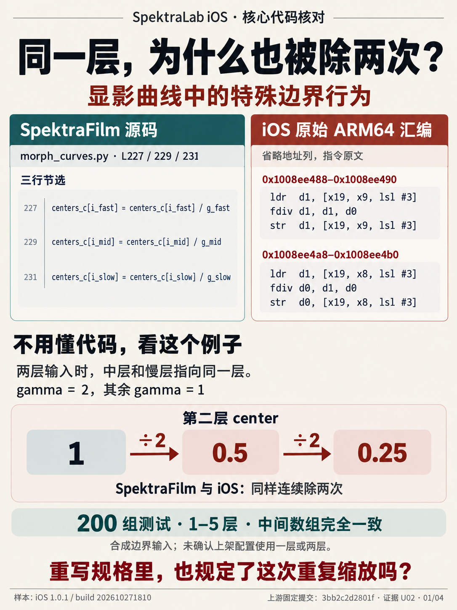
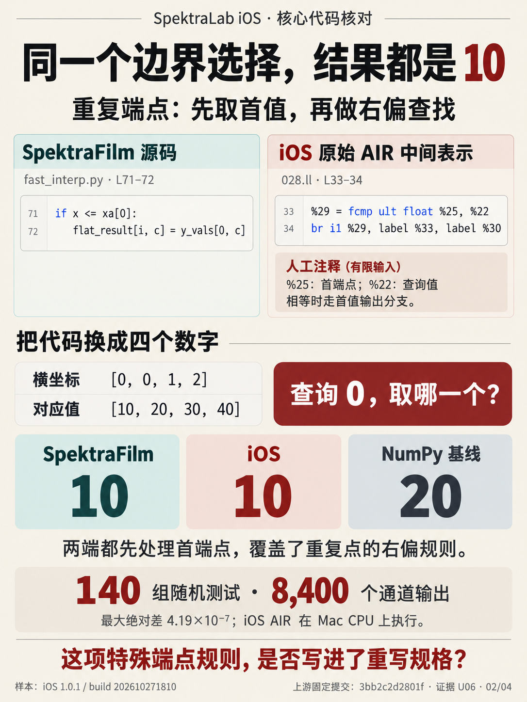
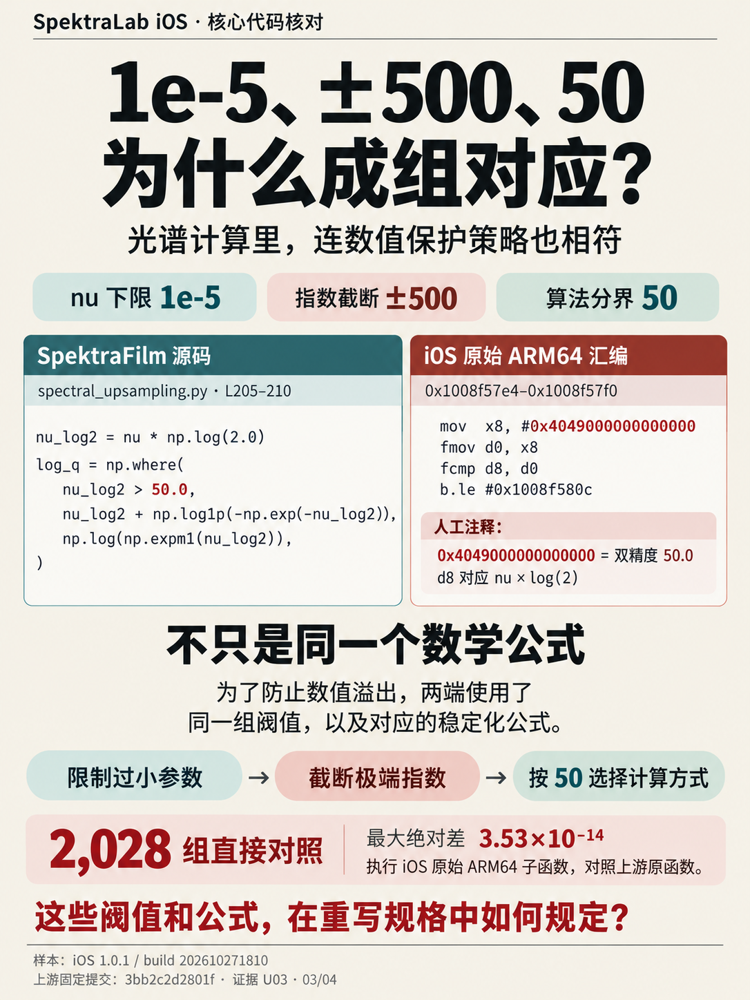
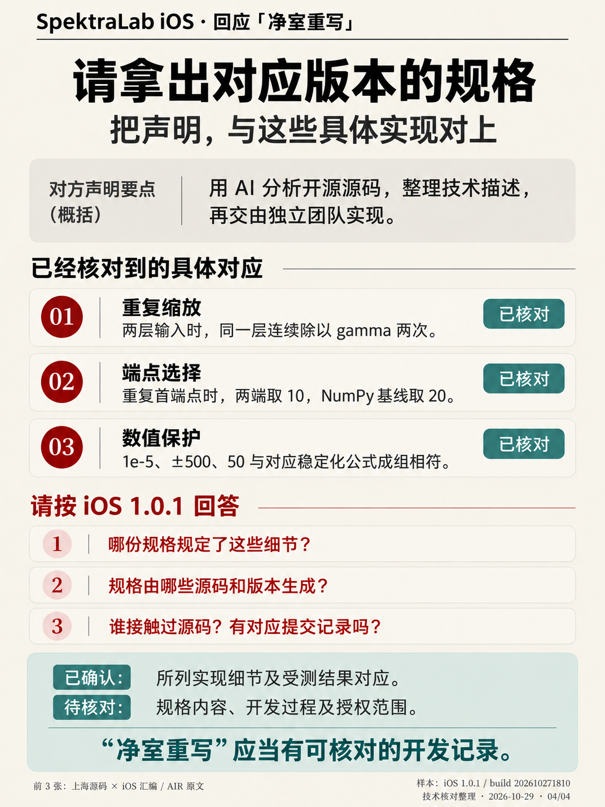

# SpektraLab iOS 代码对比证据档案

本仓库集中保存已有技术分析、固定版本的上游源码、iOS ARM64 反汇编/AIR、复现脚本和记录结果。整理日期：2026-11-01。

**已核实的核心发现：多个实现细节、边界行为和受测数值结果对应。每项结果附有样本版本、代码位置和测试范围。**

## 灯箱色卡实测

[查看 11 款配方的色彩证据包](evidence/colorchart-2026-11-11/README.md)，包括取样图、11 款 iOS 和原版输出、测量脚本及逐项数据。264 组对应色块的平均 RGB 绝对差为 1.91 个色阶（0–255）。换算为 CIEDE2000 感知色差，平均为 0.71，全部色块小于 2。

## 先看四张图：不懂代码也能读懂

下面按 **左上 → 右上 → 左下 → 右下** 排成四宫格。点击任意图片查看高清原图；图中文字是阅读辅助，原始代码与完整结果见下方证据链接。

<table>
<tr>
<td width="50%"></td>
<td width="50%"></td>
</tr>
<tr>
<td width="50%"></td>
<td width="50%"></td>
</tr>
</table>

### ① 同一个数，为什么也被除两次？

可以把“胶片层”理解为分别参与计算的几组数据。在专门构造的两层输入中，程序把“中层”和“慢层”指到了同一组数据，因此同一个数从 **1 → 0.5 → 0.25**，连续被除以 2 两次。上游与 iOS 都出现了这个具体行为，200 组测试的中间数组一致。

这里核对的是**特殊输入下的处理步骤**。两层输入属于专门构造的边界测试。看 [U02：源码、iOS 汇编与测试结果](evidence/U02.md)。

### ② 同一个位置有两个值，程序选哪一个？

给程序四个横坐标 `[0, 0, 1, 2]`，对应值为 `[10, 20, 30, 40]`。查询位置 `0` 时，上游与 iOS 都先触发首端点规则，选择 **10**；NumPy 对照得到 **20**。这定位到了分支先后顺序的一致，具体输入和返回值可以复核。

随机测试另覆盖 140 组、8,400 个通道输出，最大绝对差约 **0.000000419**；iOS AIR 在 Mac CPU 上执行。看 [U06：端点分支与测试范围](evidence/U06.md)。

### ③ 连防止计算溢出的设置，也成组对应

计算很大或很小的数时，程序会设置保护规则。双方在同一个 logistic 子函数里都使用 **0.00001 的参数下限、±500 的指数截断、50 的算法分界**，以及对应的稳定化公式。2,028 组直接对照的最大绝对差约为 **3.53 × 10⁻¹⁴**。

这一项比较的是**阈值、分支和公式的组合**，测试范围是该子函数。看 [U03：完整定位和原始结果](evidence/U03.md)。

### ④ 这些发现如何回应“净室重写”？

开发者的解释是：用 AI 分析开源实现，生成技术描述，再由独立团队实现。上述对应使问题可以具体到开发材料：

- 技术描述是否规定了重复缩放、首端点优先和这一组数值保护规则？
- 描述由哪些版本的源码生成，交给实现者的具体内容是什么？
- 与受测 build 对应的提交、构建和规格记录，能否相互核对？

**对应代码、测试输入与执行结果见各项证据页。** [查看开发者声明原图](statements/README.md)。

### 还有整条计算路径和桌面工程证据

除以上三个便于理解的例子外，完整曲线变形测试覆盖 **64 组输入、3,264 个输出**，最大绝对差约 **8.88 × 10⁻¹⁶**，详见 [U01](evidence/U01.md)。同一模块的完整路径和边界测试不重复算作独立模块。

桌面工程另有包含文档编号、文件路径的诊断字符串对应，以及自检输入和内核接口对应，详见 [D01](evidence/D01.md)、[D02](evidence/D02.md)、[D03](evidence/D03.md)。这些材料明确归入 **SpektraLab 桌面工程**，与直接对比 spektrafilm 的项目分开列出。

## 快速阅读

- [完整对比报告（纯文本）](00-summary-zh.txt)：逐项附源码、反汇编、地址和解释。
- [HTML 报告](index.html)：下载仓库后用浏览器打开。
- [开发者声明截图及出处说明](statements/README.md)。
- [复核方法与依赖](REPRODUCING.md)。
- [结构化证据索引](evidence-index.json)。

## 全部证据主题

### spektrafilm 上游相关

| 编号 | 主题 | 记录结果 |
|---|---|---|
| U01 | [显影曲线变形与耗尽补偿：完整函数路径](evidence/U01.md) | 64 组 / 3264 个输出；最大绝对差 8.881784197001252e-16 |
| U02 | [层索引重叠：同一层被连续缩放](evidence/U02.md) | 200 组 / 1–5 层；centers、sigmas 最大绝对差 0 |
| U03 | [光谱窗口 logistic：整组稳定化阈值与分支](evidence/U03.md) | 2028 组；最大绝对差 3.530509218307998e-14 |
| U04 | [曝光补偿：忽略常数项的四阶曲面与 ±2 档限幅](evidence/U04.md) | 1500 组；最大绝对差 1.998401444325282e-15 |
| U05 | [DIR 前密度反推：完整函数与双重取负](evidence/U05.md) | 168 组 / 19296 个通道输出；最大绝对差 4.440892098500626e-16 |
| U06 | [曲线插值：首端点截断覆盖重复点右偏规则](evidence/U06.md) | 140 组 / 8400 个通道输出；最大绝对差 4.192071023645383e-07；另含 2 个边界例子 |
| U07 | [径向色域压缩：射线交点、阈值与重建](evidence/U07.md) | 624 组；最大绝对差 4.440892098500626e-16 |
| U08 | [DIR 逐像素校正：上游结构对应、桌面数值对照](evidence/U08.md) | 与桌面函数比较：10000 组 / 90000 个通道输出；最大绝对差 0 |

### SpektraLab 桌面工程相关

以下三项来源为桌面工程，单独归属，不直接计为 Andrea 上游代码命中。

| 编号 | 主题 | 记录结果 |
|---|---|---|
| D01 | [工程诊断原句：文档编号、源码路径及实际引用](evidence/D01.md) | 7 个自检字符串片段 / 636 字节；另保留早期 14 条桌面长文本命中清单，两份清单有重叠，数量不相加 |
| D02 | [浮点自检：输入、AIR 算法及零值优先分类](evidence/D02.md) | 输入 128 个 float / 512 字节一致；10,000 组随机 + 64 组启动数据输出字节一致；4 组分类器注入结果一致 |
| D03 | [34 个内核的参数名及顺序对应](evidence/D03.md) | 34 / 34 组接口匹配；取代早期 23 组统计，不累加为 57 组 |

U01 与 U02 属于同一曲线模块；U08 数值基线为桌面代码，上游部分为结构核对。这里按技术主题编排，交叉项按所属模块标注。

### 安装包与公开仓库记录

以下三项于 2026-11-11 增补，记录安装包内的明文文件和公开仓库的状态，不属于函数层面的代码对照。

| 编号 | 主题 | 记录结果 |
|---|---|---|
| P01 | [安装包内说明文件：手机仓库自述同步自桌面提交](evidence/P01.md) | 说明文件写明 "synced from the desktop's `0bca29da`"；`ENGINE-COMMIT.txt` 为 `998fd80`；两个提交在两个公开仓库中均不存在 |
| P02 | [桌面着色器内核名：42 个中 41 个在 iOS 库中同名](evidence/P02.md) | 桌面 `fd891c6`：41 / 42；事后公开的 spektralab-engine `1f6cad7`：0 / 39 |
| P03 | [桌面仓库的历史与自述](evidence/P03.md) | `main_v1` 及 23 个标签的根提交是 spektrafilm 的根提交；`main` 自 2026-11-08 起为新的根提交 |

## 已发现的差异

- 颗粒：上游先 Poisson 再 Binomial，所核查 iOS 路径采用单个 Poisson 率。
- 所选 9 份上游 Python 文件的长字符串扫描：长度至少 24 字符的原文命中数为 0。
- 耗尽参数的近零判断存在 np.allclose 与精确零判断的差异。
- 重编桌面 logistic 的指令字节与 iOS 样本存在差异。
- 移动端内核集合与所选桌面版本存在差异。

## 样本和来源

- SpektraLab iOS **1.0.1 / build 202610271810**；App Store ID **6820950508**。
- 解密主程序 SHA-256：`62c0343b402acbc35eaefc17108baf1c94336d62ee92ada656c7550603d7acff`。
- 上游 [andreavolpato/spektrafilm](https://github.com/andreavolpato/spektrafilm/tree/3bb2c2d2801ff68b92019cf1dbcbb133d60832bc)：`3bb2c2d2801ff68b92019cf1dbcbb133d60832bc`。
- 桌面 [JamesQiu2005/SpektraLab](https://github.com/JamesQiu2005/SpektraLab/tree/fd891c6bc5eb350387602deb5c1ef9b6dcdab948)：`fd891c6bc5eb350387602deb5c1ef9b6dcdab948`。

## 资料边界与更新

iOS 材料为实际编译产物的 ARM64 反汇编和 AIR 中间表示。测试范围、数值精度及基线见各项证据；开发者声明保存在 statements/。

本次为档案整理，测试数字引用此前保存的执行记录。2026-11-11 增补的灯箱色卡、CIEDE2000 色差和 P01–P03 为当日执行的记录。历史报告保存在 `history/`，其早期计数与解释以当前总报告为准。

完整 IPA、完整可执行文件、设备日志、账号、电话、客服聊天及公司调查未上传。它们不属于本仓库的可分享代码对比材料。源码和分析记录保留，移除了本机绝对路径及仅用于本地打包的工具。

[许可与署名](NOTICE.md) · [文件校验清单](file-manifest.json) · [整理记录](CURATION.json)
